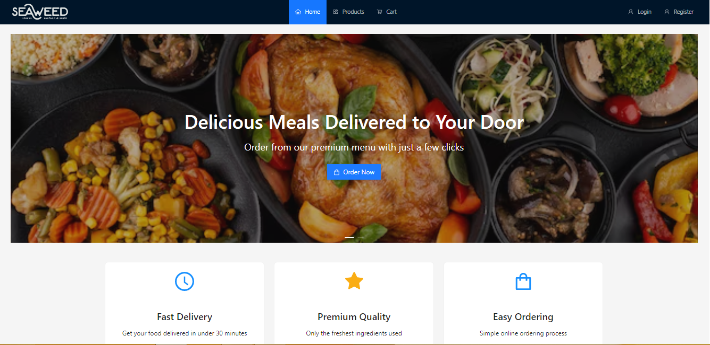

# Meal Store

A food e-commerce frontend built with React. The project provides a simple shopping experience where users can browse products, add items to their cart, and navigate through the checkout flow.

**Live Demo:** [Meal Store](https://ui88ux.github.io/meal-store/)

## Demo

<p align="center">
  <video controls width="100%">
    <source src="https://github.com/UI88UX/meal-store/releases/download/v1.0.0/mealstore-demo.webm" type="video/webm">
    Your browser does not support the video tag.
  </video>
</p>


<p align="center">
  
</p>

## Overview

Meal Store is a frontend project focused on the shopping experience of an online food store. It includes product browsing, cart management, authentication pages, and a dashboard, with a layout designed to keep navigation straightforward.

The application is built with React and Vite, using Redux Toolkit for state management, React Router for navigation, and Ant Design for UI components.

This project does not include a backend. Authentication, checkout, and other server-dependent operations are not connected to a real API, so it should be considered a frontend implementation rather than a complete e-commerce system.

## Features

- **Product browsing** — explore the available products.
- **Shopping cart** — access the cart and manage the shopping flow.
- **Authentication pages** — dedicated login and registration screens.
- **Checkout page** — a separate checkout interface.
- **Dashboard** — a dedicated dashboard page.
- **Client-side routing** — navigation between pages with React Router.
- **Lazy loading** — page components are loaded on demand.
- **Reusable UI components** — shared layout, header, footer, and Ant Design components.
- **Loading states** — loading indicators while lazy-loaded components are being resolved.

## Tech Stack

| Technology | Purpose |
| --- | --- |
| React 19 | Building the user interface |
| Vite | Development server and production builds |
| React Router | Client-side routing |
| Redux Toolkit | Application state management |
| React Redux | Connecting React components to the Redux store |
| Ant Design | UI components and layout |
| Ant Design Icons | Interface icons |
| Axios | HTTP requests |
| React Leaflet & Leaflet | Map-related UI |
| Vite PWA Plugin | Progressive Web App support |

## Getting Started

### Prerequisites

Make sure you have the following installed:

- [Node.js](https://nodejs.org/)
- npm (included with Node.js)

### Installation

Clone the repository and move into the project directory:

```bash
git clone https://github.com/UI88UX/meal-store.git
cd meal-store
```

Install the dependencies:

```bash
npm install
```

Start the development server:

```bash
npm run dev
```

Vite will display a local URL in the terminal. Open that URL in your browser to view the application.

## Available Scripts

| Command | Description |
| --- | --- |
| `npm run dev` | Start the development server |
| `npm run build` | Create a production build |
| `npm run preview` | Preview the production build locally |
| `npm run lint` | Run ESLint checks |
| `npm run deploy` | Deploy the `dist` directory using GitHub Pages tooling |
| `npm run full-deploy` | Clean, install dependencies, build, and deploy |

**Note:** Deployment scripts may depend on your operating system and GitHub Pages configuration. Review `package.json` before using them in a different environment.

## Project Structure

The main application code is organized under `src/`.

```text
src/
├── components/
│   ├── Header
│   ├── CustomFooter
│   └── PrivateRoute
├── pages/
│   ├── LandingPage
│   ├── ProductsPage
│   ├── CartPage
│   ├── LoginPage
│   ├── RegisterPage
│   ├── CheckoutPage
│   └── DashboardPage
├── store/
│   └── store
├── App.jsx
└── main.jsx
```

The structure above highlights the main application modules; individual filenames and extensions may vary.

## Backend & Data

Meal Store is a frontend-only application. There is no dedicated backend or database included in this repository.

This means:

- There is no built-in server-side authentication.
- User accounts are not verified by a project-owned backend.
- Checkout is not connected to a real payment gateway.
- Server-side product and order management is not provided.

Axios is included as a dependency, but its presence alone does not imply that a working backend API is available.

A backend can be added later to support persistent product data, user accounts, order processing, and payment integration.

## Deployment

The project includes a deployment script for GitHub Pages. You can also create a production build with:

```bash
npm run build
```

The generated files will be placed in the `dist/` directory.

For local production preview:

```bash
npm run preview
```

If you deploy the application to a different domain or subdirectory, review the router's `basename` and the Vite configuration to make sure page navigation and asset paths work correctly.

## License

No license has been specified in this repository. Unless a license is added, permission to reuse, modify, or redistribute the code should not be assumed.

---

Built as a frontend project with React, Vite, and Redux Toolkit.